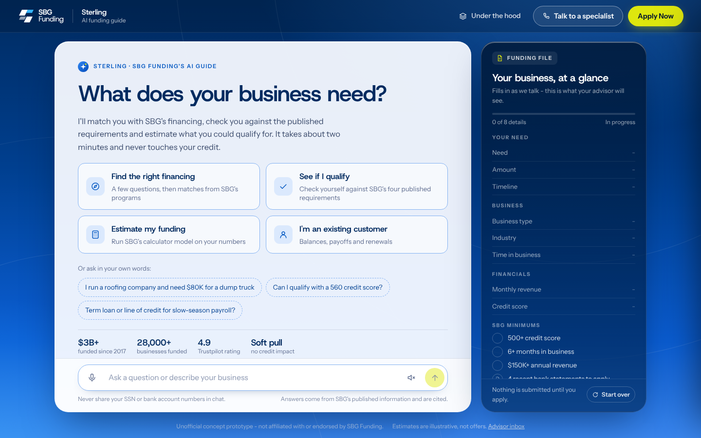
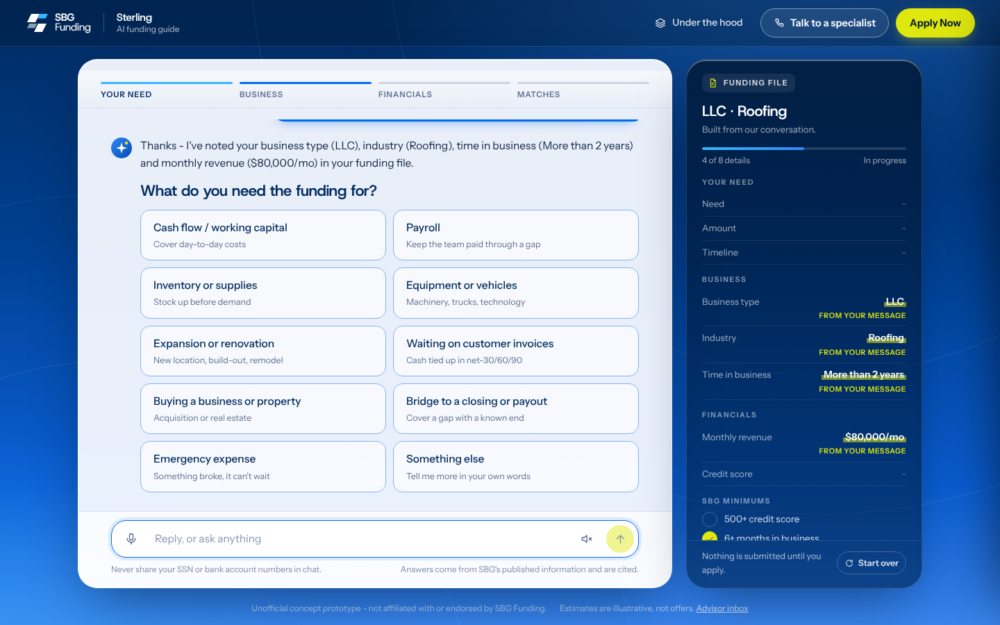
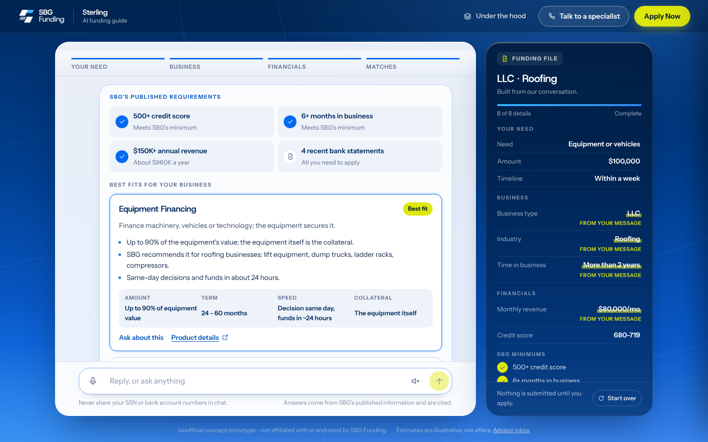
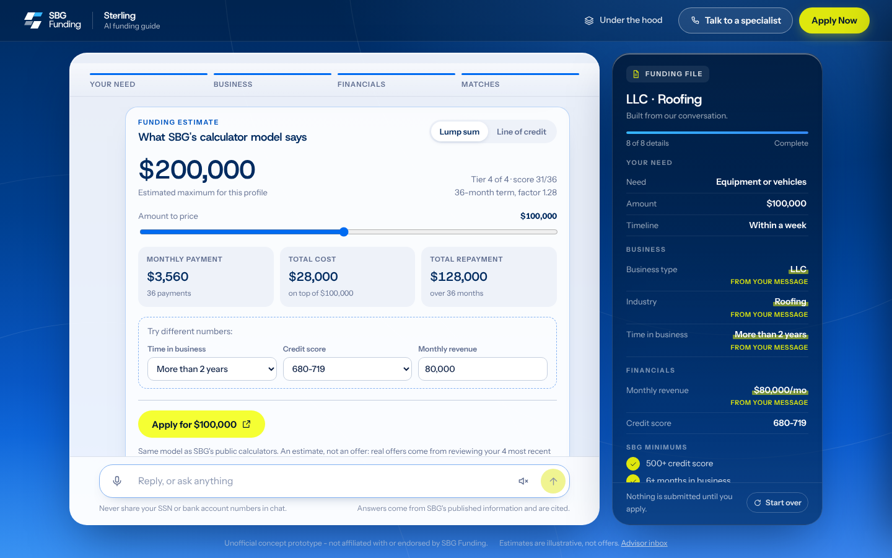
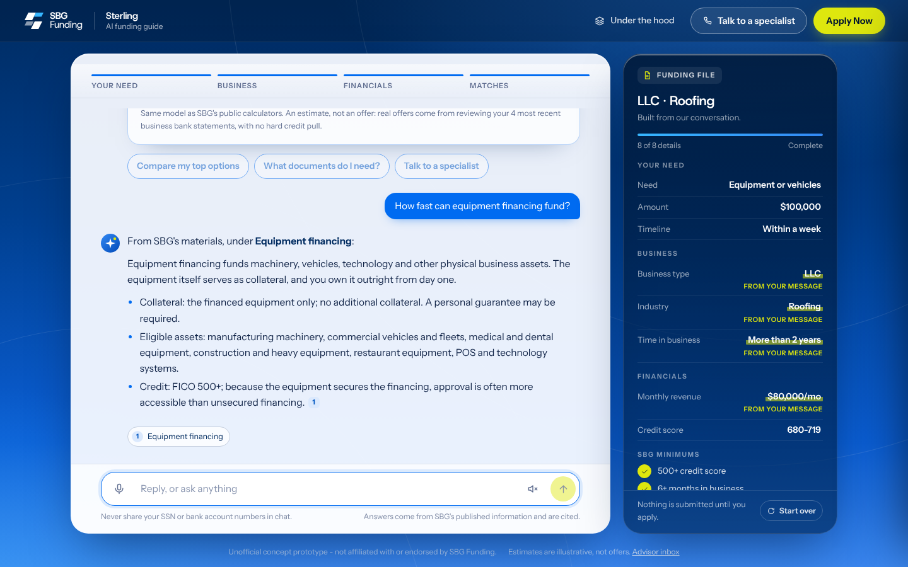
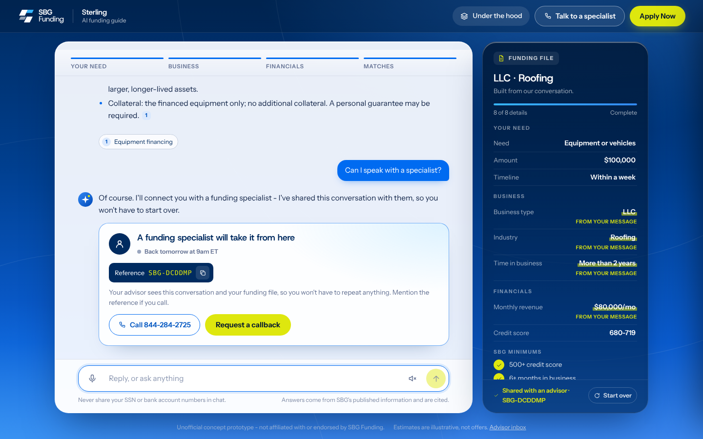
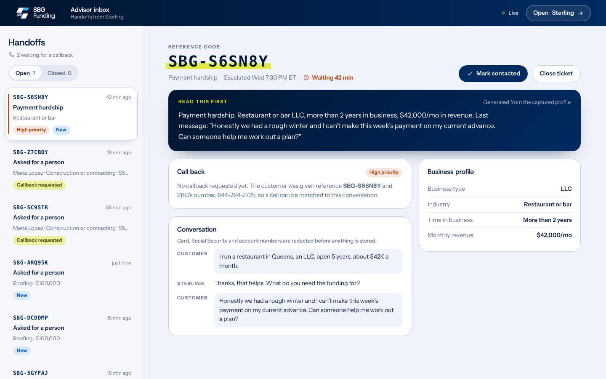
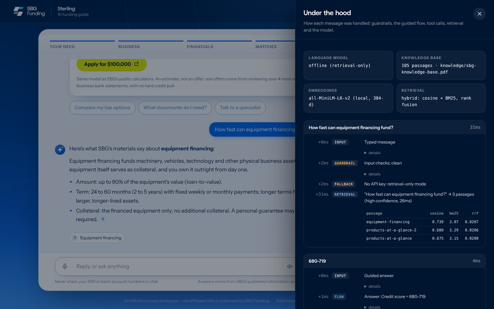
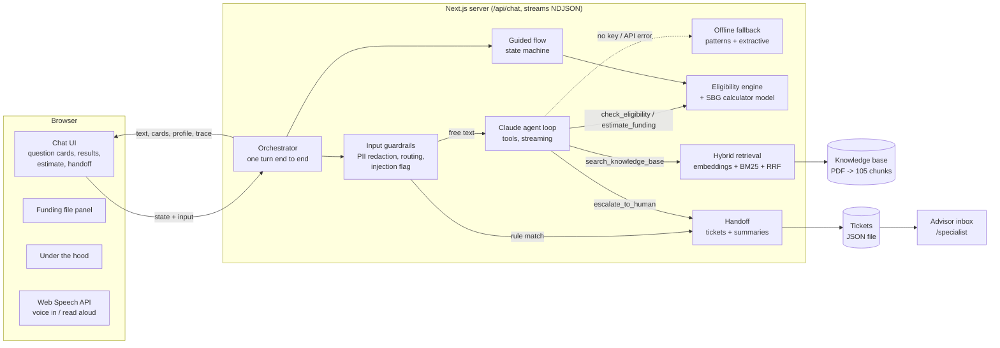

# Sterling: an AI funding guide for SBG Funding

Sterling is a concept prototype of a website assistant for [SBG Funding](https://sbgfunding.com/), a New York small-business financing company. It does four jobs that sbgfunding.com currently spreads across separate pages, forms and phone calls:

1. **Guides** a business owner through the same questions an SBG advisor asks: what the money is for, how much, how soon, entity type, industry, time in business, revenue and credit.
2. **Pre-qualifies** them against SBG's four published minimums, matches them with SBG's nine financing programs, and runs **SBG's own calculator model** to estimate an amount and payment.
3. **Answers questions** from a knowledge base built from SBG's public pages, with citations, and says so when it doesn't know.
4. **Hands off to a person** at the right moment (asked for one, complaint, payment hardship, account servicing, or a question it can't answer), with a ticket that carries the whole conversation, so the customer never repeats themselves.

> Unofficial concept prototype. Not affiliated with or endorsed by SBG Funding. Estimates are illustrative, not offers.



| One sentence fills four fields | Matches against SBG's programs |
| --- | --- |
|  |  |
| **SBG's calculator model, live** | **Answers cite SBG's own pages** |
|  |  |
| **Warm handoff with a reference code** | **What the advisor receives** |
|  |  |

"Under the hood" (top bar) opens a per-message trace: guardrail decisions, retrieval scores, tool calls, model, tokens and latency.



## Quick start

Requires Node.js 20 or newer.

```bash
npm install
```

```bash
npm run setup
```

`setup` downloads the embedding model (all-MiniLM-L6-v2, about 90 MB, checksum-verified) into `models/`. It runs locally, so no embedding API is needed.

To use Claude, put your key in `.env.local` (see `.env.example`):

```bash
cp .env.example .env.local
```

Then run it. For a demo, use the production build:

```bash
npm run build && npm start
```

Or start the dev server with hot reload:

```bash
npm run dev
```

Open http://localhost:3000. The advisor inbox is at http://localhost:3000/specialist.

**Without an API key** Sterling still works in *retrieval-only mode*. The guided flow, eligibility, estimates, guardrails and handoffs are deterministic code and behave identically. Free-text questions are answered by quoting the best knowledge-base passage, and business details are pulled from messages with patterns instead of the model. The inspector shows which mode is active.

## How it works



The design rule throughout: **code decides, the model explains.**

- **Who qualifies and for how much** is decided by deterministic code: `lib/engine/eligibility.ts` and `lib/engine/estimator.ts`, a port of the scripts behind SBG's public calculators. The model calls these as tools and is told never to compute figures itself. The same profile always gets the same answer, and every rule is unit-tested.
- **Facts about SBG** come only from retrieval over the knowledge base, cited inline as [1], [2]. Low retrieval confidence means "I don't know, want a specialist?" rather than a guess.
- **What to ask next** is a state machine (`lib/engine/flow.ts`), not the model. The model's job in the intake is to understand free text ("roofing LLC, 3 years, $80K a month") and fill the profile through a tool call.
- **Sensitive messages never reach the model.** Hardship, complaints and requests for a person are routed by rules first. Social Security, card and account numbers are redacted before anything is sent or stored.

More detail: [docs/ARCHITECTURE.md](docs/ARCHITECTURE.md).

## Evaluation

```bash
npm run eval
```

Retrieval, 46 hand-written questions with known answer passages plus 5 off-topic questions (`evals/retrieval.json`):

| Mode | hit@1 | hit@3 | hit@5 | MRR | Off-topic flagged |
| --- | --- | --- | --- | --- | --- |
| Dense (embeddings) | 73.9% | 89.1% | 93.5% | 0.819 | 100% |
| BM25 (keywords) | 52.2% | 71.7% | 84.8% | 0.637 | 60% |
| **Hybrid (RRF)** | **73.9%** | **93.5%** | **95.7%** | **0.839** | **100%** |

Hybrid search keeps dense search's precision and adds BM25's recall on exact terms like phone numbers, "7(a)" and legal names. The BM25 weight (0.3) was chosen with `npm run eval -- --sweep`.

Guardrail routing, 35 messages (`evals/routing.json`): 100% route accuracy, escalation precision and recall, and PII redaction. These cases were written alongside the rules (six of them after a bug turned up in testing), so they show the rules do what was intended, not how they generalize. Production would need a held-out set drawn from real conversations.

```bash
npm test
```

100 tests. Unit tests cover the calculator model (against values computed by hand from SBG's formulas), eligibility and product ranking, the intake flow, guardrails, BM25 and retrieval-only answers. Contract tests drive the agent loop against a mock of the Messages API that streams real server-sent events.

## Project layout

```
app/                    Next.js routes: chat UI, advisor inbox, /api/chat, /api/handoff, /api/health
components/             UI: chat, question/result/estimate/handoff cards, funding file, inspector, inbox
lib/agent/              Claude client, system prompt, tool definitions, agent loop, offline fallback
lib/chat/               Turn orchestrator and the client-server protocol
lib/engine/             Profile, guided flow, eligibility, calculator model, guardrails, business hours
lib/rag/                PDF parsing, chunking, local embeddings, BM25, hybrid retriever
lib/handoff/            Tickets, summaries, escalation
lib/sbg/                SBG facts: company, products, industries
knowledge/              Knowledge base sources (Markdown) and the generated PDF
scripts/                setup-model, build-kb-pdf, ingest, eval
evals/                  Golden sets and the latest results
tests/                  Unit and contract tests
docs/                   Architecture, study guide, interview prep, research notes
```

## Scripts

| Command | What it does |
| --- | --- |
| `npm run setup` | Downloads and verifies the local embedding model |
| `npm run kb:pdf` | Rebuilds `knowledge/sbg-knowledge-base.pdf` from `knowledge/source/*.md` |
| `npm run ingest` | Parses the PDF, chunks it, embeds every chunk and writes `data/kb-index.json` |
| `npm run eval` | Retrieval and guardrail evaluation (`-- --sweep` tunes the fusion weight) |
| `npm test` | Unit and contract tests |
| `npm run lint` / `npm run typecheck` | ESLint and TypeScript |

## Configuration

| Variable | Default | Purpose |
| --- | --- | --- |
| `ANTHROPIC_API_KEY` | none | Enables Claude. Without it, retrieval-only mode. |
| `ANTHROPIC_MODEL` | a current Claude model | Which Claude model to use |
| `ANTHROPIC_EFFORT` | `low` | Reasoning effort: `low` keeps replies fast for chat |
| `ANTHROPIC_FALLBACKS` | on | Set to `off` to stop requesting server-side refusal fallbacks (a beta) |
| `STERLING_OFFLINE` | unset | Set to `1` to force retrieval-only mode |
| `STERLING_HANDOFF_FILE` | `data/handoffs.json` | Where tickets are stored |

## Troubleshooting

"Under the hood" shows which mode is active and any Claude API error for each message.

| You see | Fix |
| --- | --- |
| Language model: offline (retrieval-only) | The key wasn't loaded. Check `.env.local` and restart the server. |
| Claude API error 401 | The key is invalid or revoked. |
| Claude API error 404 (model not found) | Set `ANTHROPIC_MODEL` to a model your account can use. |
| Claude API error 400 mentioning fallbacks or betas | Set `ANTHROPIC_FALLBACKS=off`. |
| "Embedding model not found in ./models" | Run `npm run setup`, then restart. |

Model errors never break the app: that message falls back to retrieval-only mode and the trace records why.

## Known limitations

- **Prototype storage.** Tickets live in a JSON file and the advisor inbox has no sign-in. Production would use a CRM or ticketing system behind staff SSO.
- **Knowledge base is a snapshot.** It was written from SBG's public pages in October 2026 and paraphrased into a PDF. Where SBG publishes nothing (some fees, exact turnaround by product), the knowledge base says so rather than inventing a number. Rules that SBG doesn't publish were written for this prototype and are marked in [docs/RESEARCH_NOTES.md](docs/RESEARCH_NOTES.md).
- **Three retrieval misses** in the eval set are documented in `evals/results.json`, for example "Do you lend in Texas?". The answer ("all 50 states") is in the knowledge base, but no passage mentions Texas.
- **Voice** uses the browser's Web Speech API, so speech input works in Chrome, Edge and Safari but not Firefox.
- **Retrieval-only mode** answers with the best-matching passage, which is accurate but less direct than Claude's answers.
