# System design

The complete set of system design diagrams for Sterling. It starts with the whole system, then zooms into every part: the request path, the frontend, the AI agent, retrieval, the rules engine, the human handoff, data, failure handling, voice, testing and security. The last section explains in detail how the design would scale.

Every diagram matches the code on this branch. Where something is a prototype shortcut, or hasn't been verified (for example live Claude calls with a real key), the text says so. The diagrams are written in Mermaid, so they render on GitHub as well as in the PDF.

**Contents**

1. [High-level architecture](#1-high-level-architecture)
2. [Life of a request](#2-life-of-a-request)
3. [Frontend](#3-frontend)
4. [AI agent](#4-ai-agent)
5. [Retrieval (RAG)](#5-retrieval-rag)
6. [Rules engine](#6-rules-engine)
7. [Human handoff](#7-human-handoff)
8. [Data model](#8-data-model)
9. [Failure handling](#9-failure-handling)
10. [Voice](#10-voice)
11. [Observability and testing](#11-observability-and-testing)
12. [Security boundaries](#12-security-boundaries)
13. [Scaling](#13-scaling)

## 1. High-level architecture

### 1.1 System context

Who and what Sterling talks to.

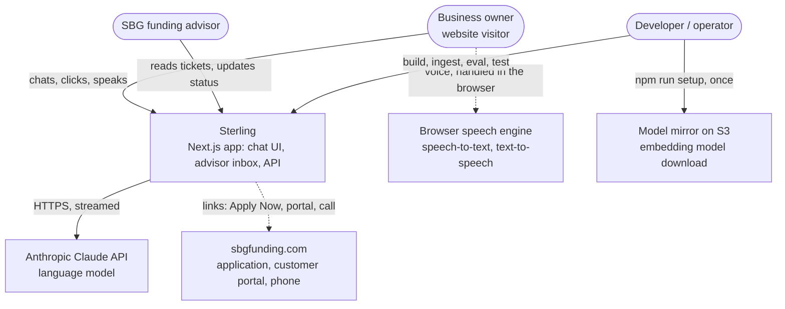

- **Business owners** use the chat at `/`. **Advisors** use the inbox at `/specialist`.
- The only external API the running app calls is **Claude**. Embeddings are computed locally, so there is no embedding API.
- **Speech** is handled entirely by the browser. Sterling's server only ever receives text.
- **sbgfunding.com** is only linked to (Apply Now, customer portal, `tel:` links). No SBG system is called.

### 1.2 Containers and runtime

What runs where, and what lives in memory and on disk.

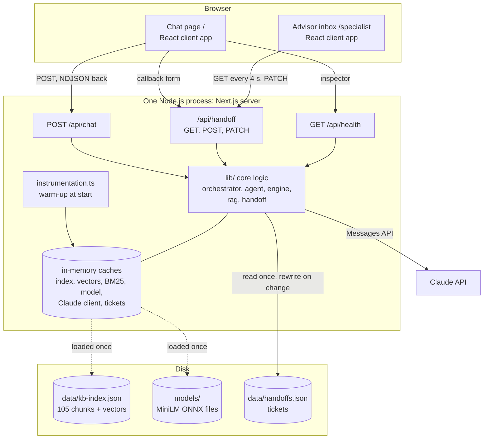

- **One process does everything.** Pages, API routes, retrieval and the embedding model all run inside the same Next.js server.
- **The server is stateless between requests.** The conversation lives in the browser and is sent with every request. The only server-side state is caches, plus the ticket file.
- **Warm-up:** at startup, `instrumentation.ts` loads the index and the embedding model, so the first visitor doesn't wait for them.

### 1.3 Module layers

How the code is organised and which layer may call which.

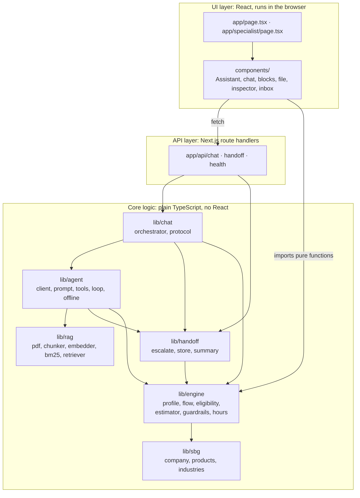

- **`lib/` has no React,** so all the logic is testable without a browser.
- **The browser imports some pure functions directly.** The estimate slider re-runs `estimateFunding()` in the browser, the funding file calls `evaluate()`, and the progress bar calls `progress()`. The same code gives the same answer on both sides.
- **`lib/chat/protocol.ts` is the contract** shared by browser and server: the request shape, every event type, and the handoff reasons.

### 1.4 Build and run

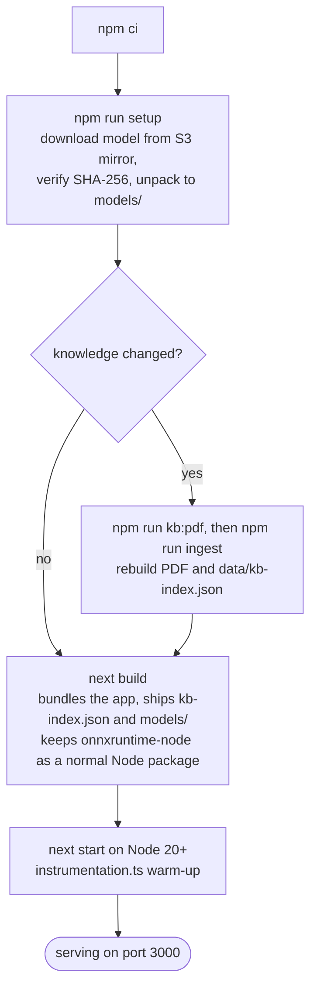

- `data/kb-index.json` is committed to the repo, so a fresh clone only needs `npm ci`, `npm run setup`, `npm run build` and `npm start`.
- `next.config.ts` marks `@huggingface/transformers`, `onnxruntime-node` and `sharp` as external packages, because they use native code. It also includes the index and model files in the build output.

### 1.5 Every call the system makes

| # | From → to | Call | When | Code |
|---|---|---|---|---|
| 1 | Browser → server | `POST /api/chat`, NDJSON stream back | Every click, typed or spoken message | `components/chat/useChat.ts` |
| 2 | Browser → server | `POST /api/handoff` | Callback form submitted | `components/blocks/HandoffCard.tsx` |
| 3 | Browser → server | `GET /api/handoff` | Advisor inbox, on load and every 4 s | `components/inbox/Inbox.tsx` |
| 4 | Browser → server | `PATCH /api/handoff` | Mark contacted, close, reopen | `components/inbox/Inbox.tsx` |
| 5 | Browser → server | `GET /api/health` | "Under the hood" opened | `components/inspector/Inspector.tsx` |
| 6 | Server → Claude | Messages API, streamed, 1 to 6 per typed message | Typed message that passes the guardrails, with a key | `lib/agent/agent.ts` |
| 7 | Server → Claude | Messages API, not streamed | Background, after a handoff response is sent | `lib/handoff/summary.ts` |
| 8 | Server → disk | Read `kb-index.json` and the model files | Once, at startup or first search | `lib/rag/retriever.ts`, `embedder.ts` |
| 9 | Server → disk | Read and write `handoffs.json` | First ticket access, then every change | `lib/handoff/store.ts` |
| 10 | Browser → speech engine | SpeechRecognition, speechSynthesis | Mic button, read aloud | `components/chat/voice.ts` |
| 11 | Setup script → S3 | Download the model archive | `npm run setup`, once | `scripts/setup-model.ts` |
| 12 | Browser → sbgfunding.com | Plain links | User clicks Apply Now, portal or call | `lib/sbg/company.ts` |

There are no other network calls: no database, no analytics and no embedding API. The Claude client retries failed calls twice (with the SDK's backoff) and times out after 60 seconds.

## 2. Life of a request

### 2.1 One chat turn, end to end

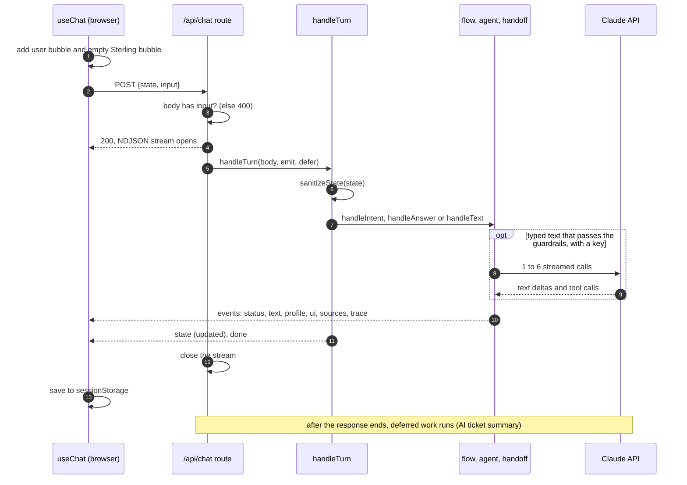

- The browser sends the **whole conversation state** with every request, and gets an updated copy back in the `state` event. That is what keeps the server stateless.
- Events are written to the stream as they happen, so text, cards and funding-file updates appear immediately.
- If the browser disconnects, the turn still finishes on the server and further writes are ignored.

### 2.2 The orchestrator's routing

`lib/chat/orchestrator.ts` decides what kind of turn this is.

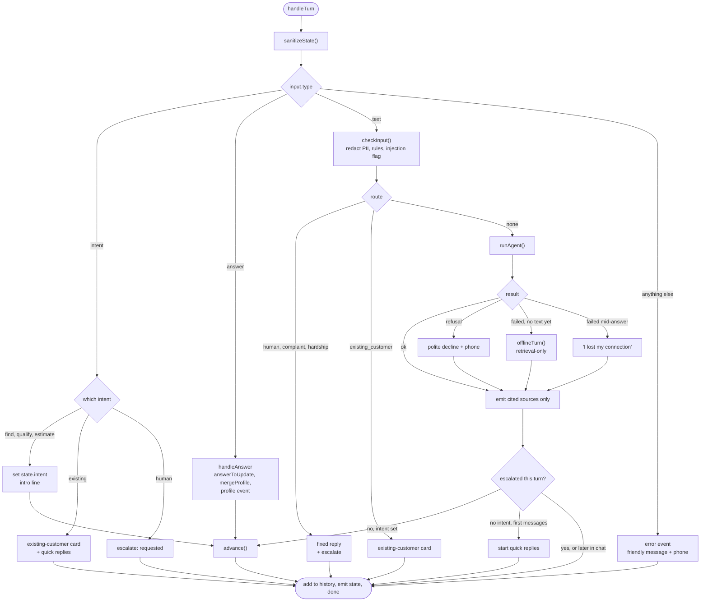

- **Clicks (intent, answer) never call Claude.** Only free text can.
- **Sensitive messages never reach Claude.** The rules match first and the turn ends with a handoff.
- Whatever the path, every turn ends the same way: the assistant's words go into the history (capped at 24 turns), then `state` and `done` are sent.

### 2.3 What shows next: `advance()`

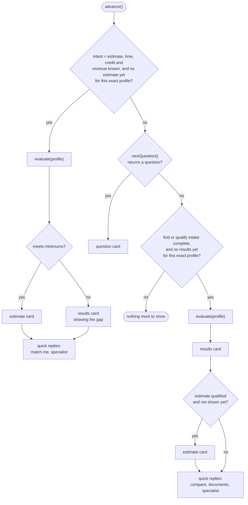

"For this exact profile" means `profileKey()`: a sorted JSON fingerprint of the profile, stored in `resultsKey` and `estimateKey`. The same results are never shown twice, but they are shown again if a field changes.

### 2.4 The stream protocol

Each line of the response is one JSON object. These are the events the server sends and what the browser does with each:

| Event | Payload | What `useChat` does |
|---|---|---|
| `status` | label | Shows a line like "Searching SBG's knowledge base…" |
| `text` | delta | Appends to the Sterling bubble |
| `ui` | block: question, results, estimate, handoff, existing_customer, pii_notice or quick_replies | Adds a card under the text |
| `profile` | profile, changed fields, via `answer` or `ai` | Updates the funding file and highlights the new fields |
| `sources` | the cited passages | Shows source chips under the answer |
| `trace` | ms since start, type, label, data | Adds to this turn's trace ("Under the hood") |
| `error` | message | Shows an error note on the bubble |
| `state` | the full `ClientState` | Replaces the stored state, which is sent with the next request |
| `done` | nothing | Marks the bubble finished |

The response headers are `application/x-ndjson`, `Cache-Control: no-cache, no-transform` and `X-Accel-Buffering: no`, so proxies don't hold the stream back.

How the browser reads it:

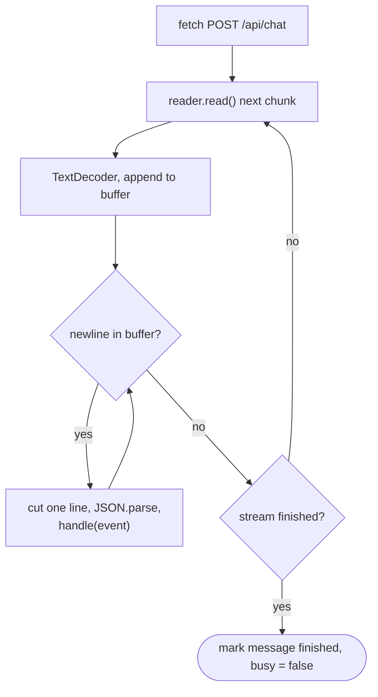

**Why NDJSON over `fetch`:** one message is one request with a one-way stream back, so there's no connection to manage and it passes through normal proxies. The browser's `EventSource` (Server-Sent Events) only sends GET requests, and the state has to be POSTed. WebSockets are built for long-lived two-way traffic, which this doesn't need.

## 3. Frontend

### 3.1 Pages

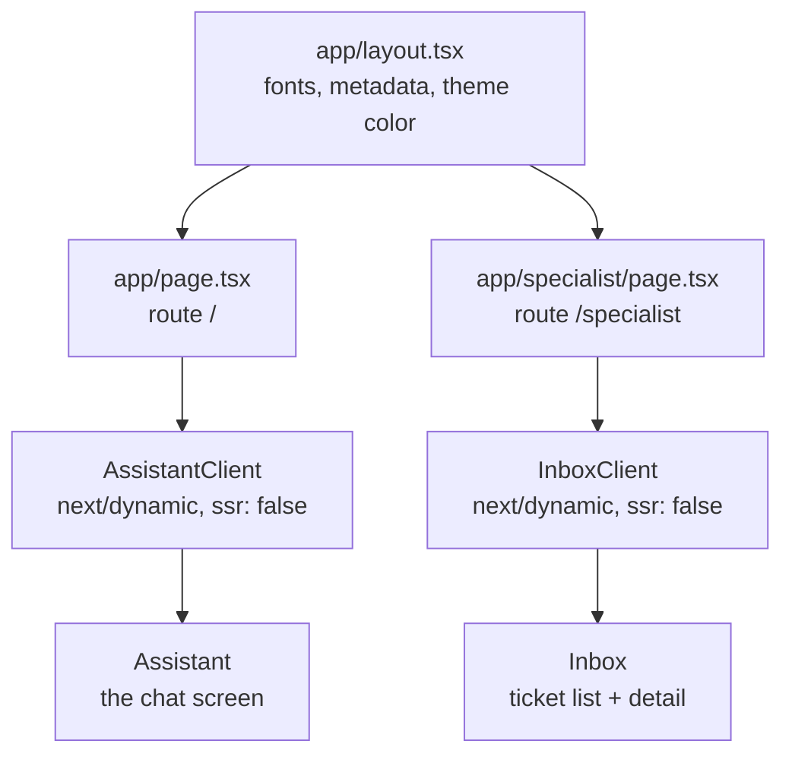

Both screens are **browser-only** (`ssr: false`). The chat restores the conversation from sessionStorage and detects voice support on first render. Neither exists on the server, and an app screen gains nothing from server rendering.

### 3.2 Inside the chat screen

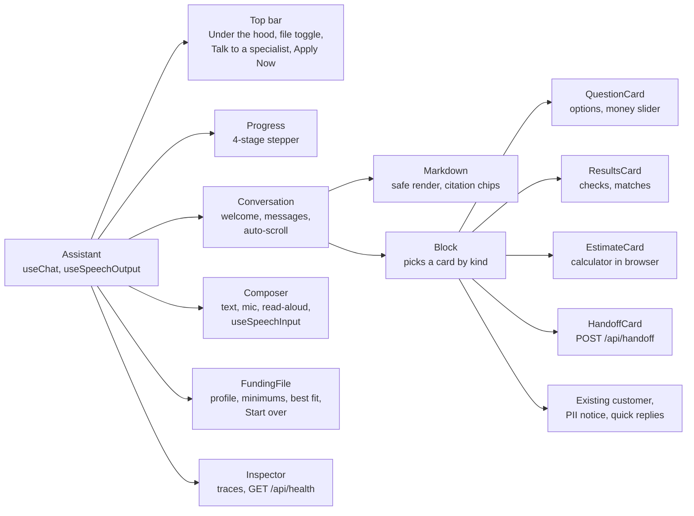

- **Every user action becomes one `send(input, label)` call:** a click on a card, a quick reply, the welcome screen, the top bar, or a typed or spoken message.
- **`Markdown`** builds React elements instead of using `innerHTML`, so model output can't inject HTML. It turns `[n]` into citation chips.
- **`EstimateCard`** re-runs the calculator in the browser when the slider moves, with no server call.
- **The funding file** shows how many fields are filled (for example 5/8). It becomes a bottom sheet on phones.

### 3.3 Client state and storage

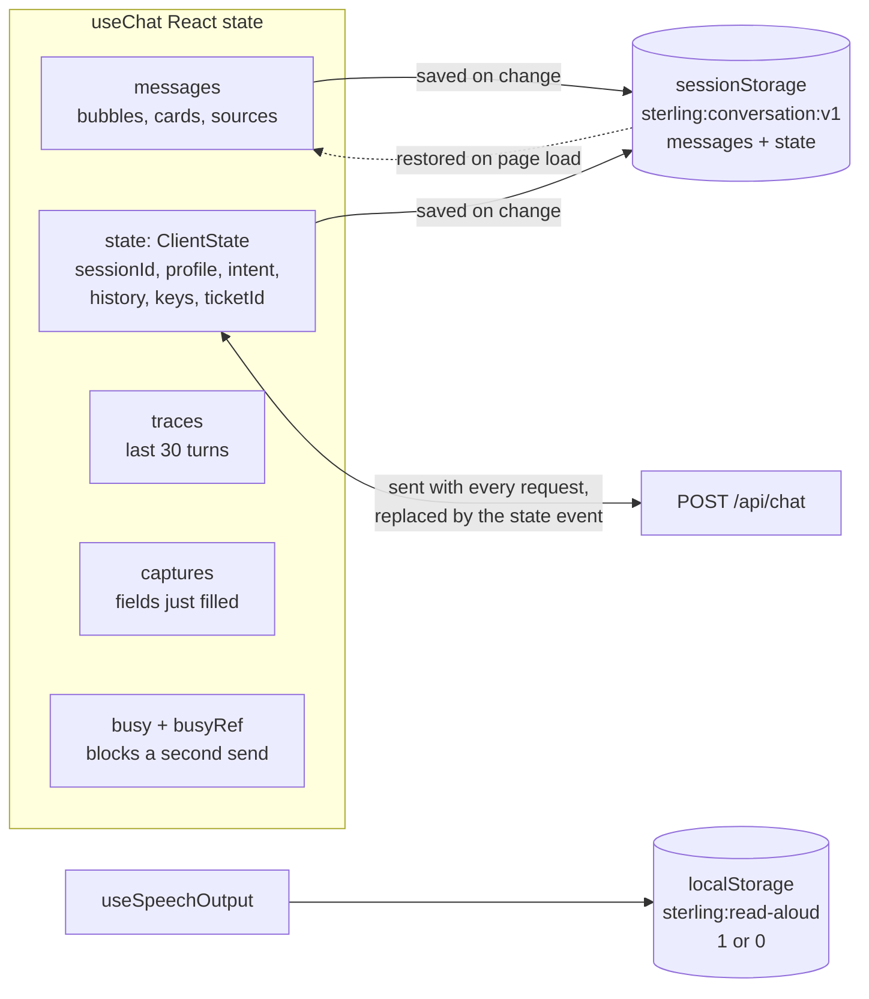

- **sessionStorage** is per tab. A refresh keeps the conversation, closing the tab clears it, and so does "Start over".
- **localStorage** holds only the read-aloud preference.
- The session id is made in the browser from the time plus a counter. It is a label, not a secret.

## 4. AI agent

### 4.1 Prompt anatomy and caching

What one Claude request contains, in order:

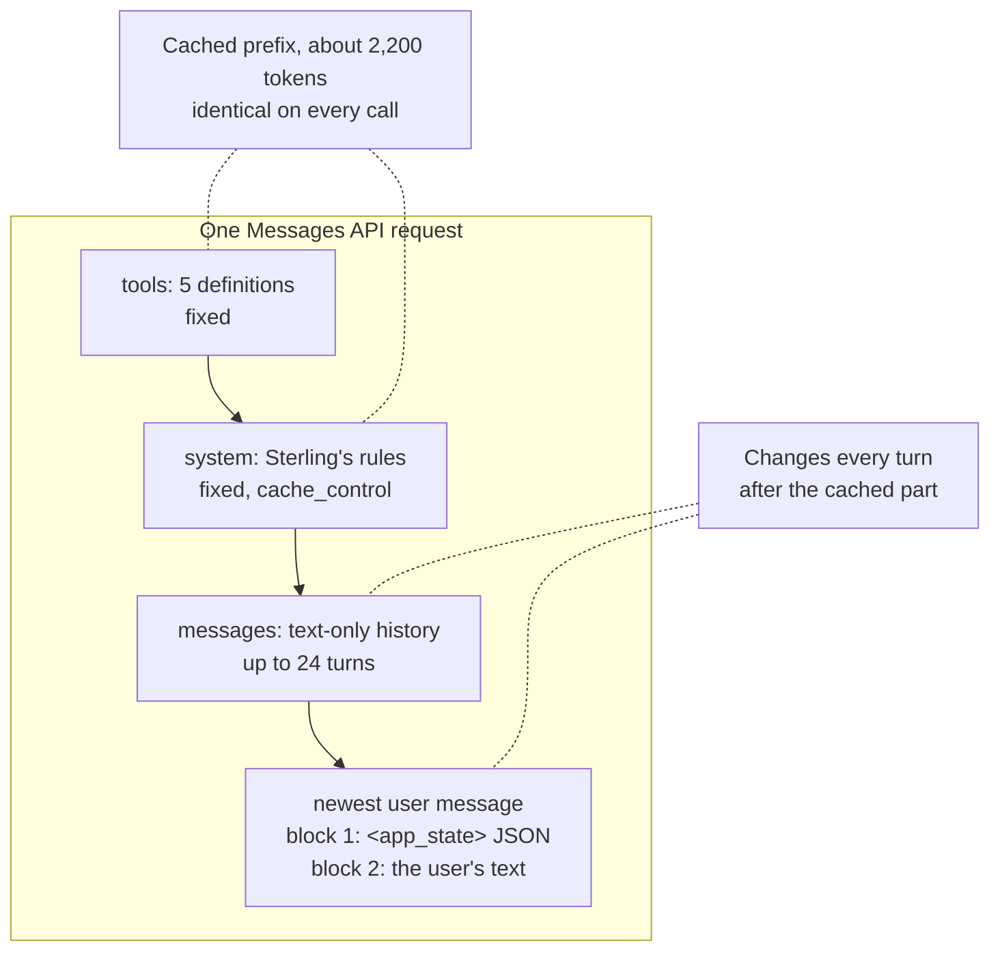

- **Prompt caching works on the beginning of the request.** The tool definitions and system prompt never change, so they can be reused from the cache. Everything that changes goes after them.
- **Where the varying context goes:** the `<app_state>` block holds what changes per turn, placed on the newest user message rather than in the system prompt:

| `<app_state>` field | Meaning |
|---|---|
| `now` | Current New York time, e.g. "Wednesday 6:42 PM ET" |
| `advisorsAvailableNow` | Whether advisors are open (Mon–Fri, 9am–6pm ET) |
| `guidedFlow` | The current intent, or "not started" |
| `profile` | The readable profile captured so far |
| `intake` | Whether a guided question is pending, and its text |
| `meetsPublishedMinimums` | true, false, or null if not known yet |
| `resultsAlreadyShown`, `escalatedTicket` | So Claude doesn't repeat them |

**Request settings:**
- **model:** set by `ANTHROPIC_MODEL`, with a current Claude model as the default.
- **max_tokens:** 8,000.
- **Thinking and effort:** adaptive thinking at effort `low`, set by `ANTHROPIC_EFFORT`.
- **Fallbacks:** server-side refusal fallbacks are on (a beta, which `ANTHROPIC_FALLBACKS=off` disables).
- **Streaming:** the response is streamed, and tool inputs stream as they're written.

**Prompt caching only kicks in above a minimum prefix size.** For current models that is 512 tokens, but some older models need up to 4,096. "Under the hood" shows cache read and write tokens per call, so you can check it's working; it hasn't been verified live yet.

### 4.2 The agent loop

`runAgent()` in `lib/agent/agent.ts`:

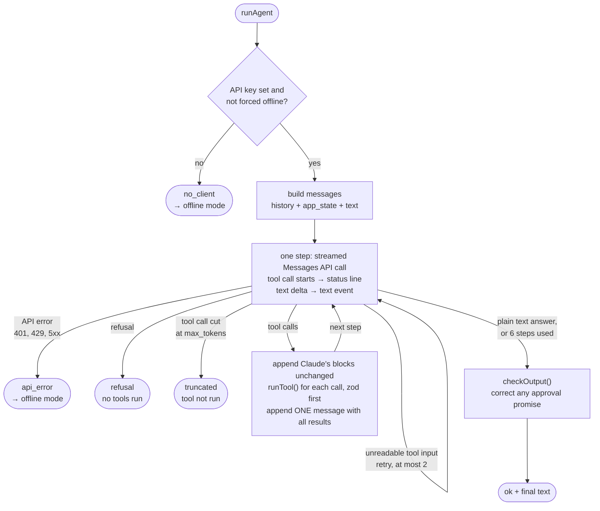

Every step also records a trace: model, stop reason, input and output tokens, cache tokens and time.

- **Within a turn, Claude's blocks go back unchanged,** including its thinking, as the API requires when tools are used. **Between turns, only text is kept.** That keeps requests small and history simple.
- **All tool results go back together** in one user message, so Claude can call several tools in parallel.
- **The 6-step cap** stops a loop that never ends. A retry after unreadable tool input uses one of the 6 steps.

### 4.3 A typed message with two tools

The most common shape of a typed turn: two Claude calls.

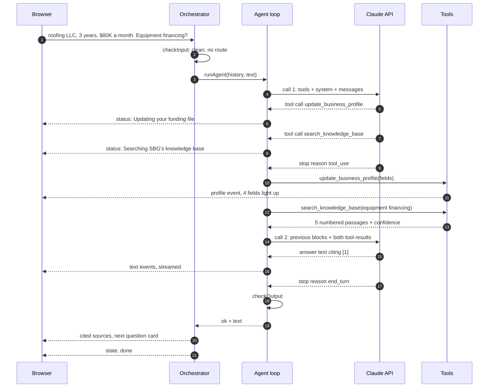

- **1 call:** Claude answers without tools.
- **2 calls:** the typical case shown above.
- **3 to 6 calls:** chained tools, for example search, then eligibility, then escalation.

### 4.4 The five tools

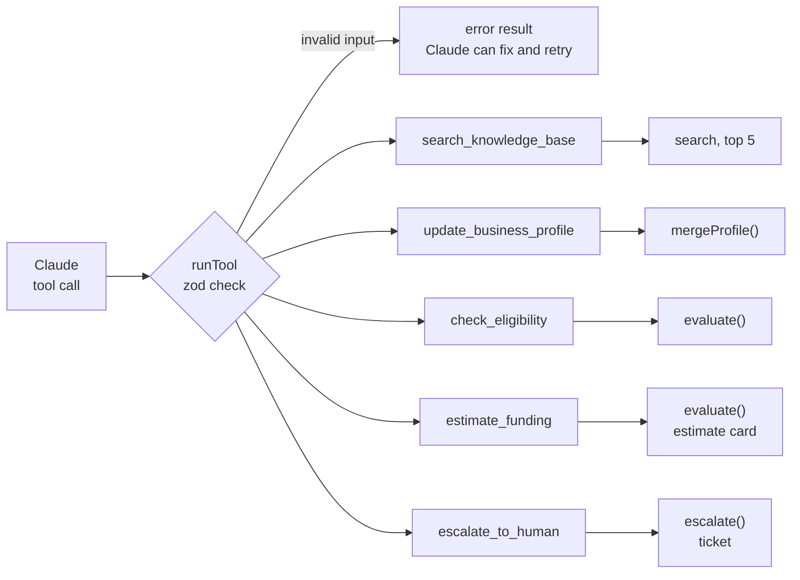

| Tool | Input (checked with zod) | What runs | Effect on screen | Returned to Claude |
|---|---|---|---|---|
| `search_knowledge_base` | `query`, 1–300 characters | `search(query, {k: 5})`; passages are numbered in order of first use | Status line; retrieval trace with scores | Passages with `[n]`, title, source, text; confidence; a "don't answer from general knowledge" note when low |
| `update_business_profile` | Any profile fields, with months in business instead of a bucket | Months → bucket; `mergeProfile()`; sets the intent to `find` if none | `profile` event, funding file highlight | Saved fields, and which fields are still needed |
| `check_eligibility` | none | `evaluate()` + `summarizeEligibility()` | Trace only | Checks, top 5 matches, estimates, missing fields, disclaimer |
| `estimate_funding` | Optional `requestedAmount` for a what-if | Checks required fields, then `evaluate()` | Estimate card if minimums are met | Estimate, or what's missing or failing |
| `escalate_to_human` | `reason` (7 values), `note` up to 500 characters | `escalate()` | Handoff card; ticket created | Ticket id and what the customer now sees |

**Why zod:** tool inputs stream as Claude writes them, and in that mode the API doesn't validate them against the schema. The tools are thin wrappers: **Claude decides when to call them, and the code decides the answer.**

## 5. Retrieval (RAG)

### 5.1 Offline ingestion

This runs on a developer machine, not while serving users.

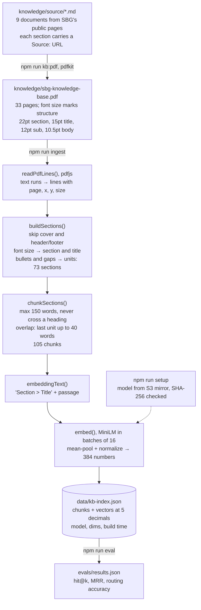

- **Why go through a PDF at all:** the brief was "RAG over the company's PDF". Real companies hand over PDFs, so the pipeline has to recover structure from layout.
- **Structure-aware chunking:** one product, FAQ or industry is one unit of meaning, so a chunk never mixes two topics.
- **The contextual header** ("Financing products > Business line of credit") lets a chunk that only says "Limit: $5K–$500K" still match "line of credit limit".

### 5.2 Online hybrid search

`search()` in `lib/rag/retriever.ts`, run for every knowledge question:

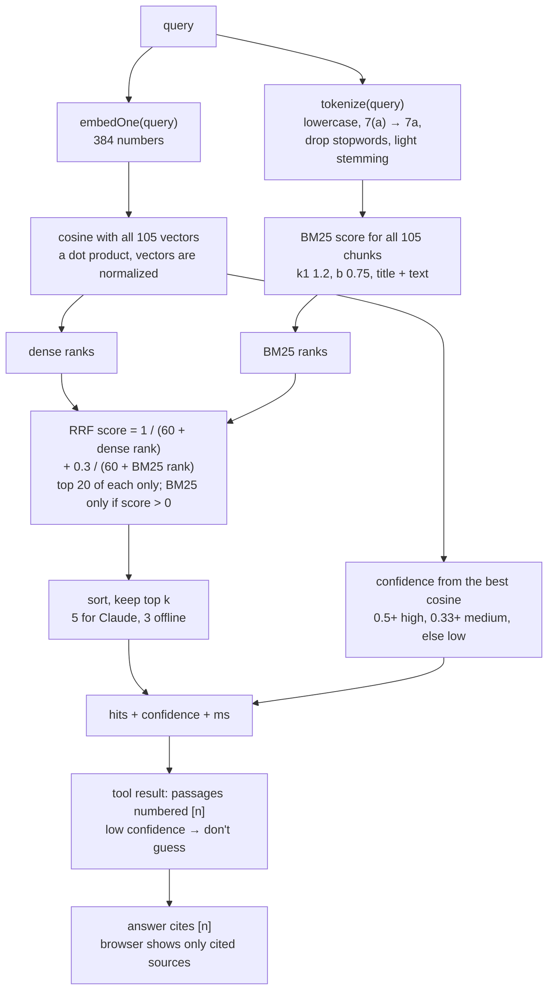

**Memory:** the index, the 105 vectors and the BM25 statistics are built once and cached on `globalThis`. A whole search, including embedding the query, took about 9 ms in testing.

**Measured on 46 questions with known answers, plus 5 off-topic questions:**

| Mode | Top 1 | Top 3 | MRR | Off-topic flagged |
|---|---|---|---|---|
| Dense only | 73.9% | 89.1% | 0.819 | 100% |
| BM25 only | 52.2% | 71.7% | 0.637 | 60% |
| **Hybrid (weight 0.3)** | **73.9%** | **93.5%** | **0.839** | **100%** |

## 6. Rules engine

### 6.1 Guardrails

`checkInput()` and `checkOutput()` in `lib/engine/guardrails.ts`:

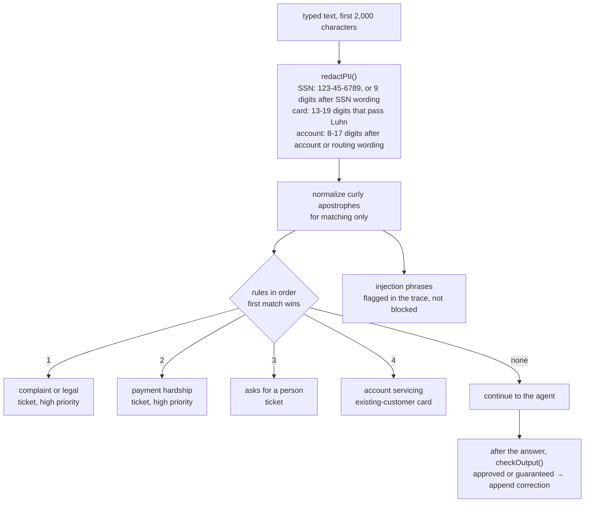

- **The redacted text is the only version used afterwards:** for Claude, the history and tickets. The user sees a notice card.
- **Why rules and not the model:** these cases are too important to leave to a model's judgment, and rules are instant, free, predictable and testable. The routing eval has 35 messages, all routed correctly. Those cases were written alongside the rules, so they prove intent, not how the rules generalize.

### 6.2 Guided intake

`nextQuestion()` in `lib/engine/flow.ts` is a small state machine:

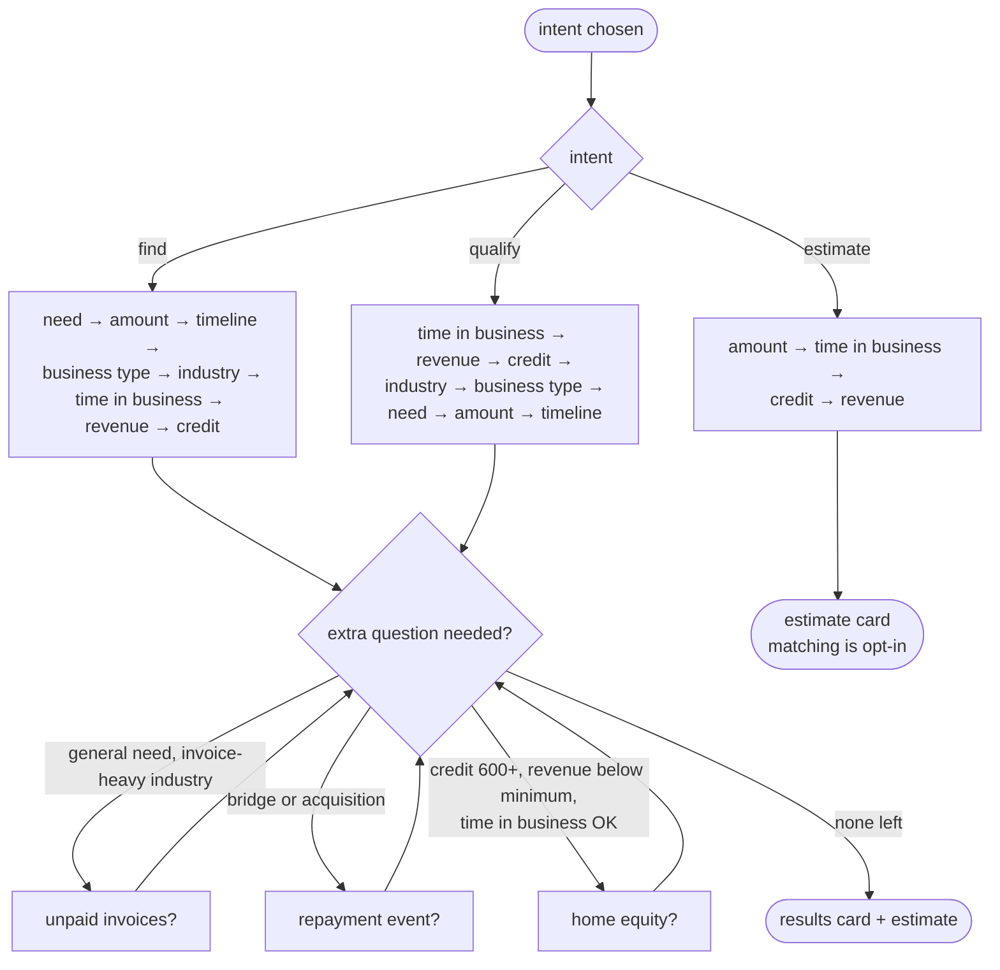

- **It always asks the first unanswered field.** Anything already captured from typed text is skipped.
- **The progress bar** maps fields to four stages: Your need (need, amount, timeline), Business (type, industry, time), Financials (revenue, credit, extras) and Matches.

### 6.3 Eligibility and product matching

`evaluate()` in `lib/engine/eligibility.ts`:

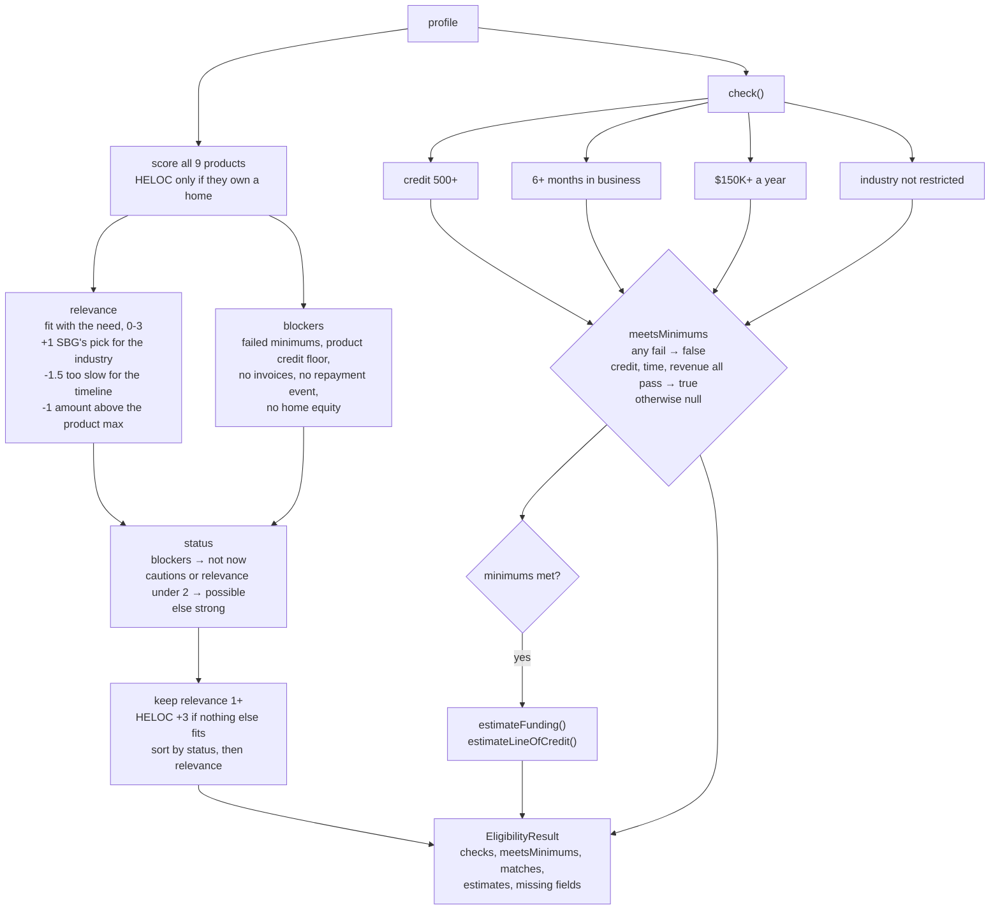

**The bank statements:** SBG's fourth minimum, four recent bank statements, is shown as information, not checked. Product-wide notes (like the SBA paperwork) are shown, but they don't lower a product's status. Some ranking weights were written for this prototype, not taken from SBG; `docs/RESEARCH_NOTES.md` lists them.

### 6.4 The funding calculator

`estimateFunding()` in `lib/engine/estimator.ts`, a port of SBG's public calculator:

```mermaid
flowchart TB
  in["time in business, credit, monthly revenue"] --> pts["points<br/>time 0-11, credit 0-11, revenue 1-14"]
  pts --> sc["score = sum, 1 to 36"]
  sc --> tier{"tier"}
  tier -->|"below 10"| none["no automatic estimate<br/>suggest HELOC or advisor"]
  tier -->|"10-16"| t1["0.75 × revenue<br/>1.22, 12 mo, weekly"]
  tier -->|"17-21"| t2["1.5 × revenue<br/>1.24, 15 mo, weekly"]
  tier -->|"22-30"| t3["2.25 × revenue<br/>1.26, 24 mo, twice a month"]
  tier -->|"31-36"| t4["2.5 × revenue<br/>1.28, 36 mo, monthly"]
  t1 & t2 & t3 & t4 --> mx["max amount = revenue rounded up to its bracket<br/>× multiplier, rounded up to $100"]
  mx --> pay["payment = amount × rate factor ÷ number of payments<br/>total cost = amount × (factor - 1)"]
```

- **Line of credit:** the limit is 2 × monthly revenue, rounded up to $5K and capped at $500K. It's priced at factor 1.28 over 24 months.
- **Worked example:** more than 2 years (11) + credit 600–679 (3) + $50K a month (14) = 28. Then $112,500 max. Pricing $50K gives 48 payments of about $1,310 and $13,000 total cost.

## 7. Human handoff

### 7.1 End to end

```mermaid
sequenceDiagram
  autonumber
  participant B as Browser
  participant O as Orchestrator / agent
  participant E as escalate()
  participant S as Ticket store
  participant C as Claude API
  participant I as Advisor inbox
  B->>O: button, rule-matched text, or Claude's tool call
  O->>E: escalate(reason, note)
  E->>S: getTicket(state.ticketId)
  alt this chat already has a ticket
    E->>S: updateTicket (priority never drops)
  else first handoff
    E->>S: createTicket (SBG-XXXXXX, status new)
  end
  S->>S: write data/handoffs.json, chained
  E-->>B: handoff card: code, phone, hours
  O-->>B: state with ticketId, done
  Note over E,C: after the response is sent (Next.js after)
  E->>C: aiSummary(ticket)
  C-->>E: three-sentence advisor note
  E->>S: replace the template summary
  B->>S: POST /api/handoff callback form
  S->>S: status callback_requested
  loop every 4 seconds
    I->>S: GET /api/handoff
  end
  I->>S: PATCH status
```

**What a ticket carries:**
- a reference code: `SBG-` + 6 characters from an alphabet without look-alikes, readable over the phone;
- the reason and priority;
- the profile;
- the eligibility result and top matches, for new-financing leads only;
- the last 16 messages, already PII-redacted;
- the assistant's note;
- a summary.

**How the summary is made:**
- The template summary is written instantly, with no AI.
- The AI summary replaces it in the background, so the customer never waits.
- If Claude isn't available, the template stays.

**Priority:** complaint and hardship tickets are high priority and carry no product pitch. Business hours are computed in New York time ("Advisors are available now" or "Back Monday at 9am ET").

### 7.2 Ticket lifecycle

```mermaid
stateDiagram-v2
  [*] --> new: escalate() creates the ticket
  new --> callback_requested: customer submits the callback form
  new --> contacted: advisor marks contacted
  callback_requested --> contacted: advisor marks contacted
  new --> closed: advisor closes
  callback_requested --> closed: advisor closes
  contacted --> closed: advisor closes
  closed --> new: advisor reopens
```

These are the transitions the UI offers. The server doesn't enforce them: `PATCH` accepts any status, and a callback request moves any ticket to `callback_requested`.

**Inbox order:** `rank = (high priority ? 0 : 10) + status`, with status scored callback requested 0, new 1, contacted 2, closed 3. Ties go newest first. One quirk: a closed high-priority ticket sorts above an open normal one.

### 7.3 Ticket store internals

`lib/handoff/store.ts`:

```mermaid
flowchart TB
  storecall["createTicket, updateTicket,<br/>listTickets, getTicket"] --> load{"tickets already in memory?"}
  load -->|"no"| rf["read data/handoffs.json<br/>missing → empty list"] --> mem
  load -->|"yes"| mem[("in-memory array<br/>newest first")]
  mem --> chg["create or update in memory"]
  chg --> chain["persist(): add to the write chain<br/>one write at a time"]
  chain --> wf["create the folder, write the whole file"]
  wf -->|"read-only filesystem"| keep["keep in memory only"]
```

- **Chained writes** mean two requests can't interleave and lose a ticket.
- **The weakness:** it is one file per server process, rewritten in full on every change. Section 13 replaces it.

## 8. Data model

```mermaid
erDiagram
  CLIENT_STATE ||--|| PROFILE : holds
  CLIENT_STATE ||--o{ HISTORY_TURN : "history, max 24"
  CLIENT_STATE |o--o| TICKET : "ticketId"
  TICKET ||--|| PROFILE : "snapshot"
  TICKET ||--o{ HISTORY_TURN : "transcript, last 16"
  TICKET |o--o| CONTACT : "callback details"
  CLIENT_STATE {
    string sessionId
    enum intent
    string resultsKey
    string estimateKey
    string ticketId
  }
  PROFILE {
    enum purpose
    number amount
    enum timeline
    enum businessType
    enum industry
    enum timeInBusiness
    number monthlyRevenue
    int creditScore
    bool hasInvoices
    bool repaymentEvent
    bool ownsHome
  }
  HISTORY_TURN {
    enum role
    string text
  }
  TICKET {
    string id
    string sessionId
    enum status
    enum reason
    enum priority
    string summary
    enum summarySource
    string note
    bool meetsMinimums
    list topMatches
    date createdAt
    date updatedAt
  }
  CONTACT {
    string name
    string phone
    string email
    string bestTime
    string message
  }
```

The knowledge index is separate. It's built offline and read-only at runtime:

```mermaid
erDiagram
  KNOWLEDGE_INDEX ||--|{ CHUNK : "105 chunks"
  KNOWLEDGE_INDEX {
    string model
    int dims
    date builtAt
    string sourcePdf
  }
  CHUNK {
    string id
    string section
    string title
    string text
    string source
    int page
    int wordCount
    vector embedding
  }
```

| Data | Where it lives | Lifetime |
|---|---|---|
| Conversation (`ClientState` + messages) | Browser sessionStorage; sent with each request | Until the tab closes or "Start over" |
| Read-aloud preference | Browser localStorage | Until cleared |
| Tickets | `data/handoffs.json` + in-memory cache | Permanent (prototype) |
| Knowledge index | `data/kb-index.json`, committed; in memory at runtime | Until the next ingest |
| Embedding model | `models/`, git-ignored; in memory at runtime | Until replaced |
| Products, industries, minimums, hours | Code: `lib/sbg/` | Deploy-time |

**Profile validation:** every profile goes through the zod `ProfileSchema`. Purpose, timeline, business type, industry and time-in-business are fixed lists. Amount must be $1K–$50M. Credit must be 300–850.

## 9. Failure handling

```mermaid
flowchart TB
  msg["typed message"] --> key{"Claude configured?"}
  key -->|"no key or STERLING_OFFLINE=1"| off
  key -->|"yes"| cl["Claude agent loop<br/>SDK: 2 retries, 60 s timeout"]
  cl -->|"answer"| ok(["grounded answer with citations"])
  cl -->|"error before any text"| off["retrieval-only mode"]
  cl -->|"error after some text"| lost(["'lost my connection' + phone"])
  cl -->|"refusal"| ref(["polite decline + phone"])
  off --> pii{"PII was redacted?"}
  pii -->|"yes"| safe(["fixed safety reply"])
  pii -->|"no"| ext["extractProfile(): patterns for<br/>LLC, $40K a month, credit 650, ..."]
  ext --> stmt{"a statement with new details?"}
  stmt -->|"yes"| noted(["'Thanks - I've noted ...'"])
  stmt -->|"no"| s3["search, top 3"]
  s3 --> conf{"confidence"}
  conf -->|"high or medium"| quote(["quote the best passage with [1]"])
  conf -->|"low"| hum(["'don't want to guess'<br/>+ Talk to a specialist"])
```

| Fault | Where it's caught | What the user gets |
|---|---|---|
| No API key, or `STERLING_OFFLINE=1` | `getClient()` returns nothing | Retrieval-only answers; everything else unchanged |
| API error (401, 404, 429, 5xx, timeout) | `runAgent` catch | That message in retrieval-only mode; trace says why |
| Failure after part of the answer streamed | `runAgent` returns partial text | "I lost my connection for a moment" + phone |
| Refusal | stop reason `refusal` | Polite decline + phone; no tools run |
| Unreadable streamed tool input | `runAgent` catch | Step retried, up to 2 times |
| Reply cut at max_tokens mid tool call | stop reason check | Tool not run; treated as a failure |
| Embedding model or index missing | Warm-up logs a warning; search throws | Error message + phone; `/api/health` says how to fix it |
| AI summary fails | `aiSummary` returns null | Template summary stays on the ticket |
| Read-only filesystem | `persist()` catch | Tickets kept in memory |
| Browser disconnects mid-stream | `emit` catch | Turn finishes quietly on the server |
| Any other error in a turn | `handleTurn` catch | "Something went wrong on our side" + phone |

**The key property:** the guided flow, eligibility, calculator and handoffs are deterministic code. They work the same with or without Claude.

## 10. Voice

```mermaid
sequenceDiagram
  participant U as User
  participant C as Composer
  participant S as Browser speech engine
  participant H as useChat
  participant A as Assistant
  U->>C: click the mic
  C->>S: recognition.start(), en-US, live results
  S-->>C: words as they're heard
  U->>S: stops speaking
  S-->>C: final transcript, onend
  C->>H: send(text), same as typing
  H-->>A: reply finished streaming
  A->>A: speakable() strips [n], bold, links
  A->>S: speechSynthesis.speak(), en-US voice, rate 1.03
  S-->>U: audio
```

- **Speech-to-text** works in Chrome, Edge and Safari, not Firefox. In Chrome the audio is typically transcribed by Google's servers. Sterling's server only gets the text.
- **Text-to-speech** uses voices installed on the device, and works in all modern browsers.
- **Not verified:** voice hasn't been tested with a real microphone.

## 11. Observability and testing

### 11.1 Per-turn traces

```mermaid
flowchart TB
  steps["every step of a turn<br/>input, guardrail, flow, tool, retrieval,<br/>llm, handoff, fallback, error"] --> tr["trace(type, label, data)<br/>t = ms since the request started"]
  tr --> nd["trace event in the NDJSON stream"]
  nd --> uc["useChat stores it per turn<br/>last 30 turns"]
  uc --> insp["Inspector drawer<br/>timeline + retrieval scores table"]
  hl["GET /api/health<br/>model + effort, index size, advisor hours"] --> insp
```

**What the `llm` trace records:** model, stop reason, input and output tokens, cache read and write tokens, latency, and whether a fallback model answered. That covers what you'd chart in production: latency, cost and cache hit rate.

### 11.2 How the agent is tested without a key

```mermaid
flowchart TB
  test["tests/agent.test.ts<br/>scripted Claude turns"] --> env["ANTHROPIC_BASE_URL<br/>points at the mock server"]
  env --> run["runAgent() with the real Anthropic SDK"]
  run -->|"POST /v1/messages"| mock["tests/helpers/mock-anthropic.ts<br/>node:http server"]
  mock -->|"real SSE: message_start,<br/>content_block events, message_stop"| run
  mock --> rec["records every request body"]
  run --> asr["assert: events emitted, tools run,<br/>refusal and truncation handling,<br/>request shape and settings"]
```

| Suite | What it checks |
|---|---|
| `estimator.test.ts` | Calculator against values worked out by hand from SBG's formulas |
| `eligibility.test.ts` | Published minimums, product matching |
| `flow.test.ts` | Intake order, conditional questions, progress, answer conversion |
| `guardrails.test.ts` | Routing golden set, PII redaction, injection flag, output check |
| `retrieval.test.ts` | Tokenizer and BM25 |
| `offline.test.ts` | Pattern extraction and retrieval-only answers |
| `agent.test.ts` | The agent loop against the mock Messages API |
| `npm run eval` | Retrieval (46 + 5 questions, three modes), routing (35 messages), `--sweep` for the BM25 weight |

That's 100 tests in 7 files. The test run writes tickets to a separate file (`STERLING_HANDOFF_FILE` in `vitest.config.ts`).

## 12. Security boundaries

```mermaid
flowchart LR
  subgraph untrusted["Untrusted inputs"]
    br["Browser<br/>state, input, callback form,<br/>inbox actions"]
    model["Model output<br/>tool inputs, text"]
    docs["Retrieved passages"]
  end
  subgraph checks["Checks at the boundary"]
    k1["sanitizeState<br/>zod profile, caps on<br/>history and strings"]
    k2["checkInput<br/>PII redaction, routing,<br/>injection flag"]
    k4["zod on /api/handoff bodies<br/>+ PII redaction on notes"]
    k3["zod on every tool input"]
    k5["checkOutput on the answer"]
    k6["system prompt: retrieved text<br/>is content, not commands"]
  end
  trusted["Trusted code decides<br/>eligibility, calculator,<br/>flow, routing, tickets"]
  br --> k1 --> trusted
  br --> k2 --> trusted
  br --> k4 --> trusted
  model --> k3 --> trusted
  model --> k5
  docs --> k6
```

**Known gaps in the prototype**, to say out loud:
- **No login on the advisor side.** `/specialist` and `/api/handoff` are open, so anyone with the link can read tickets.
- **Ticket ownership isn't checked.** A forged `ticketId` in the state can overwrite another conversation's ticket on escalation.
- **History content isn't verified.** A tampered client can insert fake assistant messages to steer Claude.
- **No rate limiting** on `/api/chat`, so abuse costs model spend.
- **Status transitions aren't enforced** on `PATCH /api/handoff`.

Section 13.9 shows how each is closed.

## 13. Scaling

### 13.1 What breaks first

| Part | Today | Why it breaks at scale | Fix |
|---|---|---|---|
| Ticket store | JSON file per process, rewritten in full | Two servers means two different ticket lists; writes slow down as the file grows | Postgres, synced to SBG's CRM |
| Conversation state | Sent by the browser every turn | Tamperable; request size grows (up to about 48 KB of history) | Server-side session store (Redis), browser sends only a session id |
| Advisor inbox | Polls the full ticket list every 4 s | 50 advisors means 12.5 requests a second, each returning every ticket | Paginated queries + push updates (SSE or WebSocket) |
| Claude | Called directly, no limits | Org rate limits (requests and tokens per minute), cost, multi-call latency | An LLM gateway: concurrency limits, budgets, routing, caching |
| Embeddings | MiniLM on the web server's CPU | CPU work competes with request handling | Dedicated embedding service, or a cache of query vectors |
| Vector search | Brute force over 105 vectors | Fine at 105; slow and memory-heavy at 100K+ | pgvector or a vector DB with an HNSW index |
| Background work | `after()` in the same process | Lost if the process dies | Durable queue with retries |
| Abuse | No auth, no rate limits | Bots run up the model bill | WAF, bot protection, per-IP and per-session limits |

### 13.2 Capacity and cost, back of the envelope

These are **illustrative assumptions**, not SBG data. The point is the method, and which resource runs out first.

| Assumption | Value |
|---|---|
| Conversations per day | 10,000 |
| Turns per conversation | 8, of which 40% are typed (3.2 typed turns) |
| Claude calls per typed turn | 2 on average |
| Traffic window | 12 hours a day; peak = 3 × average |
| Tokens per call | 2,200 cached input, 3,000 uncached input, 400 output (including thinking) |
| Prices (check current pricing) | $4 per million input tokens, $0.20 per million cached input tokens, $20 per million output tokens |

| Result | Calculation | Value |
|---|---|---|
| Claude calls per day | 10,000 × 3.2 × 2 | 64,000 |
| Peak calls per minute | 64,000 ÷ 720 min × 3 | about 270 |
| Peak uncached input tokens per minute | 270 × 3,000 | about 0.8 million |
| Peak output tokens per minute | 270 × 400 | about 110,000 |
| Cost per call | 2,200 × $0.20/M + 3,000 × $4/M + 400 × $20/M | about $0.020 |
| Cost per conversation | 6.4 calls × $0.020 | about $0.13 |
| Cost per day / month | 64,000 × $0.020 | about $1,300 / $39,000 |
| Peak open streams | about 135 typed turns a minute × 6 s each | about 15 at once |
| Escalations | 5% of conversations | 500 tickets a day |
| Advisor time | 500 × 15 min | about 125 hours a day (16 advisors) |

**What this shows:**
- **Web servers are not the bottleneck.** Clicks cost milliseconds, and even the peak needs only a handful of open streams.
- **Claude is the bottleneck,** in tokens per minute and in cost. Most of the cost per call is uncached input (history plus tool results) and output.
- **The human side grows fastest.** At 500 handoffs a day, staffing matters more than servers, so good triage and summaries save real money.

**The "10,000 users at once" burst:**
- **Load:** if every user sends a typed message within one minute, that's about 20,000 Claude calls and 60 million input tokens in that minute. That's far above typical organization rate limits.
- **What saves it:**
  - a queue with a concurrency cap;
  - priority for handoffs over general questions;
  - the existing retrieval-only fallback for overflow;
  - a cache for common knowledge questions.
- **The web tier:** about 1,000 open streams at once is easy for a few Node instances.

### 13.3 Target production architecture

```mermaid
flowchart TB
  users(["Business owners"]) --> cdn["CDN + WAF<br/>static assets, bot protection"]
  advisors(["SBG advisors"]) --> sso["Staff SSO, OIDC<br/>inbox + ticket APIs"]
  cdn --> lb["Load balancer"]
  sso --> lb
  lb --> web["App tier: Next.js instances<br/>stateless, autoscaled"]
  web --> gw["LLM gateway<br/>concurrency, retries,<br/>budgets, routing"]
  web --> emb["Embedding service<br/>batching, query cache"]
  web --> data[("Data tier<br/>Redis: sessions, limits, cache<br/>Postgres: chats, tickets, audit<br/>pgvector: chunks, HNSW")]
  web --> q[["Queue"]]
  gw --> claude["Claude API"]
  q --> wk["Workers<br/>summaries, CRM sync, alerts"]
  wk --> gw
  wk --> data
  wk --> crm["SBG CRM"]
  wk --> slack["Slack or Teams"]
```

**What stays the same:** the orchestrator, the rules engine, the tools and the event protocol. Production changes **where state lives and how calls are controlled**, not how a turn works.

| Layer | Job | Scales by |
|---|---|---|
| Edge | TLS, caching static assets, blocking bots, staff sign-in | Managed service |
| App tier | Runs turns; holds no state | Adding instances (CPU and open connections) |
| AI tier | Controls every model call; embeds queries | Gateway instances; embedding workers |
| Data tier | Sessions, rate limits, tickets, conversations, vectors | Redis cluster; Postgres primary + read replicas |
| Async tier | Work that can happen after the reply | Adding workers |

### 13.4 A chat turn at scale

```mermaid
sequenceDiagram
  autonumber
  participant B as Browser
  participant E as Edge
  participant W as Web instance
  participant R as Redis
  participant G as LLM gateway
  participant P as Postgres
  B->>E: POST /api/chat {sessionId, input}
  E->>W: forward to any instance
  W->>R: rate limit check (IP + session)
  W->>R: load session state
  W->>W: guardrails, flow, retrieval
  W->>G: agent calls (wait in queue if at the limit)
  G-->>W: streamed tokens
  W-->>B: NDJSON events (unchanged protocol)
  W->>R: save session state
  W->>P: append redacted turn + trace (async)
```

**State moves server-side:** the browser now sends only a session id and the input. That fixes tampering, shrinks requests, and lets a ticket be bound to the session that created it.

### 13.5 Data tier

| Store | Holds | Notes |
|---|---|---|
| Redis | Session state (TTL about 24 h), rate-limit counters, query-vector and answer cache | Replaces sessionStorage as the source of truth |
| Postgres `conversations`, `messages` | Redacted transcripts, traces, model usage | Retention policy (e.g. 90 days), then delete or anonymize |
| Postgres `tickets`, `ticket_events` | Tickets + every status change (audit trail) | Indexes on `(status, priority, created_at)` for the inbox |
| Postgres `kb_versions`, `kb_chunks` | Every knowledge-base version + chunks with `vector(384)` | HNSW index; answers record which version they cite |
| Object storage | Source PDFs and documents | Versioned |

**Write path for tickets:** use a transactional outbox. The ticket row and an "event" row are written in the same transaction, and a worker publishes the event to the queue. A crash can't create a ticket that never reaches the CRM.

### 13.6 LLM tier

- **Concurrency and rate limits:** the gateway keeps requests and tokens per minute under the organization's limits. Handoffs and in-progress turns get priority over new conversations. When the queue is too long, it degrades to retrieval-only answers, which already exist.
- **Budgets:** cap calls per turn (today 6) and tokens per conversation. Alert on cost per conversation.
- **Prompt caching at scale:** every instance must send a byte-identical prefix (same tool order, same system prompt). The cache is per workspace and expires after minutes without use, so steady traffic keeps it warm.
- **Cost levers, in order:**
  1. Trim history and tool results (uncached input is most of the cost).
  2. Fewer calls per turn.
  3. Route simple turns to a smaller Claude model, but only if the eval shows no quality loss.
  4. Move non-urgent work like summaries to the batch API.
- **Latency:** streaming keeps time to first token low. Watch the 95th percentile per call, since a typed turn is 2 or more calls in sequence.
- **Caching answers:** only pure-knowledge questions, keyed by normalized question + knowledge-base version. Never personalized answers.

### 13.7 Retrieval at scale

```mermaid
flowchart TB
  cms["CMS or document store<br/>product and compliance owners"] -->|"publish webhook"| job["ingestion job"]
  job --> parse["parse + chunk"] --> embed["embed, batched"]
  embed --> stage[("new index version<br/>staging")]
  stage --> gate{"eval gate<br/>hit@3, MRR, groundedness<br/>at least as good as live?"}
  gate -->|"pass"| swap["switch the live pointer<br/>to the new version"]
  gate -->|"fail"| alert["block and alert the owners"]
  swap --> live[("live index version")]
  live --> search["search: approximate top 50<br/>+ BM25 → RRF → reranker → top 5"]
  search --> cite["answers cite chunk + version"]
```

- **Content changes don't need a deploy:** the knowledge base updates through the pipeline, and a bad version can't go live.
- **Search quality as the corpus grows:** a cross-encoder reranker over the top 50, plus eval sets built from real (redacted) questions.
- **Rollback is instant:** the previous version is one pointer switch away.

### 13.8 Handoff at scale

```mermaid
flowchart TB
  esc["escalate()"] --> tx[("Postgres: ticket row + outbox event<br/>one transaction")]
  tx --> q[["Queue"]]
  q --> s1["summary worker<br/>retries, idempotent"]
  q --> s2["CRM worker<br/>create or update the case"]
  q --> s3["alert worker<br/>high priority → Slack or Teams"]
  q --> s4["assignment<br/>by skill, hours, load"]
  s2 --> crm["SBG CRM"]
  s4 --> inbox["advisor inbox<br/>live updates, no polling"]
```

- **Assignment** replaces "everyone sees everything". Tickets go to an advisor by product skill, working hours and current load, with service-level timers per priority.
- **Callbacks** need consent recorded on the form (TCPA) and calling-hours rules.
- **The CRM becomes the source of truth.** The inbox is a view onto it, or is replaced by the CRM's own queue.

### 13.9 Security and compliance

| Gap today | Production fix |
|---|---|
| Inbox and ticket APIs open | Staff SSO (OIDC) + roles (advisor, supervisor, admin) + audit log of every view and change |
| Ticket ownership not checked | Server-side sessions; a ticket is bound to the session that created it |
| Client-held state can be tampered with | State in Redis, or signed with an HMAC if it must stay in the browser |
| No rate limiting | WAF + per-IP and per-session limits + bot protection |
| Regex-only PII redaction | Keep it, and add a PII detection service; encrypt at rest; retention limits |
| Any status transition allowed | Validate transitions server-side; record who changed what |

**Lending-specific requirements:**
- **Disclosures:** compliance review of all customer-facing wording. Commercial financing disclosure laws (for example New York's and California's) cover offers, so Sterling must keep labelling numbers as estimates.
- **Fair lending:** no protected characteristics in the profile, and the deterministic engine documented for audit.
- **Vendor terms:** data-retention terms with the model provider.

### 13.10 Reliability

- **Service levels to aim for:** time to first token under 2 seconds at the 95th percentile; under 0.5% of turns ending in an error; handoff tickets never lost.
- **Health and readiness:** `/api/health` becomes the readiness probe (index loaded, model loaded). `instrumentation.ts` already warms up before traffic arrives.
- **Circuit breaker:** when Claude's error rate spikes, switch new turns to retrieval-only for a short time instead of letting every user wait for a timeout.
- **Deploys:** blue/green or canary, with feature flags for prompt and model changes.
- **Regions:** multiple availability zones first. A second region (active-passive) only when the business needs it.

### 13.11 Observability

- **Traces:** turn today's `trace()` events into OpenTelemetry spans, one span per step, with model usage attached, and send them to the monitoring backend.
- **Dashboards:**
  - conversations started, intake completion and apply-click rate;
  - escalation rate by reason, and fallback rate;
  - retrieval confidence distribution and cache hit rate;
  - tokens and cost per conversation;
  - latency by step.
- **Quality:**
  - run `npm test` and `npm run eval` in CI on every change to prompts, models or the knowledge base;
  - grade groundedness with an LLM grader that is checked against human labels;
  - review a weekly sample of real conversations by hand.

### 13.12 More channels, same core

```mermaid
flowchart TB
  webc["Web chat"] --> core["Turn orchestrator<br/>same handleTurn"]
  sms["SMS or WhatsApp"] --> core
  phone["Phone voice agent"] --> core
  core --> ev["events: text, UI blocks, profile"]
  ev --> r1["web: cards"]
  ev --> r2["SMS: text + links"]
  ev --> r3["phone: spoken prompts"]
```

The orchestrator emits events, not HTML, so a new channel only needs a new renderer for the UI blocks.

### 13.13 Rollout plan

| Phase | Goal | Work |
|---|---|---|
| 1. Pilot | A safe, small launch | Postgres for tickets; staff SSO on the inbox; server-side sessions; rate limiting; CI with tests and evals; logging; legal review of wording |
| 2. Launch | Run as a real channel | CRM integration; queue + workers; LLM gateway; Redis; autoscaling; dashboards and alerts; assignment and service-level timers |
| 3. Scale | Cost, quality, reach | pgvector + reranker; knowledge pipeline with eval gate; embedding service; answer cache; model routing; second region if needed; new channels |
